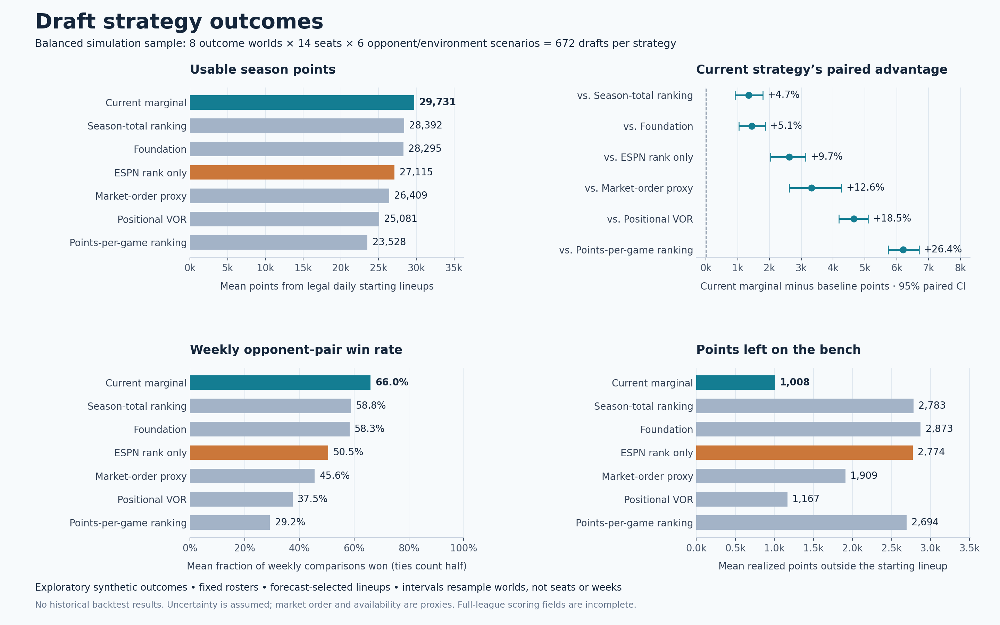

# ESPN rank-only comparison — October 15, 2026

The additional policy takes the lowest available explicit ESPN RK, with player-ID tie breaks and the same roster-feasibility constraints as the other policies. Custom fantasy points, availability, ADP, and positional bonuses do not affect its ranking. Daily lineups are still selected using the common forecast-based allocator: this isolates the effect of the draft selection rule.

Completed 48 of 48 scenario jobs, 672 ESPN-only drafts, and 8 independent outcome worlds. Each marginal reference roster was re-evaluated and matched its original points, weekly scores, usable starts, bench points, and hindsight upper bound exactly.

## Outcomes

| Strategy | Usable season points | Usable starts | Benched points | Weekly opponent-pair win rate |
|---|---:|---:|---:|---:|
| Current marginal | 29,731.2 | 677.4 | 1,007.6 | 66.0% |
| Custom season total | 28,391.8 | 644.9 | 2,782.5 | 58.8% |
| Foundation | 28,294.7 | 642.1 | 2,873.0 | 58.3% |
| ESPN rank only | 27,114.6 | 632.0 | 2,773.7 | 50.5% |
| Market-order proxy | 26,409.4 | 636.1 | 1,909.3 | 45.6% |
| Positional VOR | 25,081.4 | 527.4 | 1,166.6 | 37.5% |
| Custom points per game | 23,528.4 | 485.2 | 2,694.4 | 29.2% |

## Paired comparison

Current marginal minus ESPN rank-only: **2,616.6 points (+9.7%)**, 95% world-cluster bootstrap interval **2,030.1 to 3,135.7**. Classification within this synthetic model: **advantage supported**; exploratory with fewer than thirty worlds. The gain meets the 1% practical threshold.

Marginal wins 88.5% of paired season comparisons. Its worst-decile mean difference is -1,877.0 points.

| Opponent population | Marginal advantage | Relative gain | 95% interval | Classification |
|---|---:|---:|---|---|
| nominal | 3,290.2 | +12.9% | 2,589.6 to 3,982.5 | advantage supported |
| market | 2,581.9 | +9.1% | 2,075.0 to 3,296.4 | advantage supported |
| custom | 1,977.8 | +7.2% | 1,015.9 to 2,848.7 | advantage supported |

## Provenance and limits

- ESPN RK comes from the explicit RK column in the October 13 attended capture, not the October 10 CSV's rostered-percentage row order. All 195 benchmark players matched uniquely by normalized name; the source and ESPN identity for every join are retained in the manifest. Missing or invalid ranks cause an error rather than a fallback.
- This is an October 13 rank overlay on October 10 projections. It is not an exact reconstruction of either room, and no claim is made about an official expert rating separate from the captured RK.
- Uses exactly the original campaign's balanced seeds, synthetic schedules, primitive outcomes, opponents, and lineup allocator. Original outcome and simulation functions were checked against their saved sources. Original results remain unchanged.
- Outcome uncertainty is assumed rather than historically calibrated. PF/TF/EJ are unavailable; DD/TD/QD are generated from primitive stats. These findings remain conditional modeled/common-component results, not historical backtest evidence.
- Confidence intervals resample outcome worlds, not individual seats or weeks. Rosters are fixed; there are no trades, waivers, or streaming. Weekly win rates are opponent-pair rates, not championship probabilities.
- Twenty-four focused baseline, engine, and campaign tests passed, including strict rank coverage, ignoring custom value/availability/market signals, cache invalidation, drafted-player exclusion, and trace serialization.

