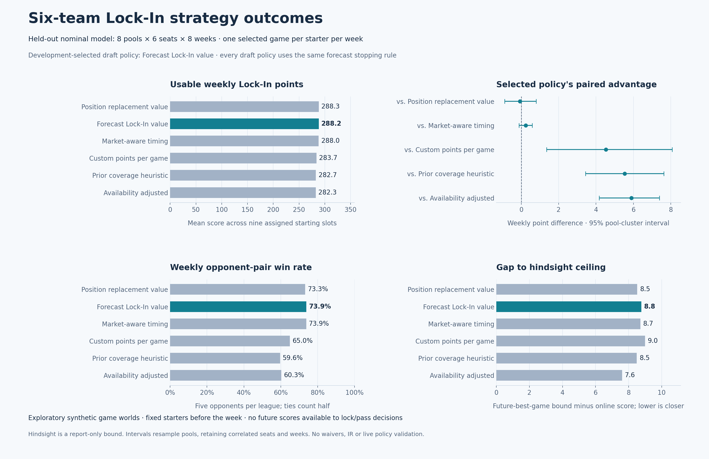
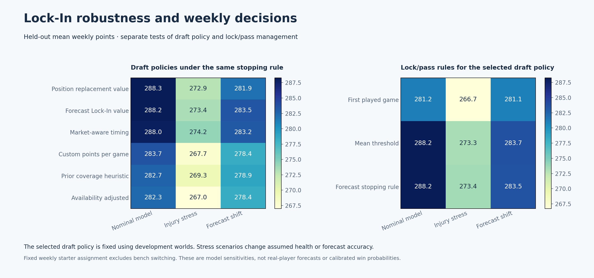

# Six-team Sleeper Lock-In study

October 17, 2026. Branch `sleeper-advisor`. This replaces the applicability of the [earlier daily-accumulation study](../../six-team/2026-10-17/README.md), whose strategy rankings are not Lock-In validation.

Settings: six teams, fourteen rounds, 84 unique draft picks, native PG/SG/G/SF/PF/F/C/UTIL/UTIL starters, five bench and one confirmed IR slot. Both DD/TD and 40+/50+ bonuses stack. Lock-In is the user-authorized working assumption based on Sleeper's default for new leagues, not an individual league API read-back. [Strategy profile](../../../../docs/SIX_TEAM_LOCK_IN_STRATEGY.md) · [Machine-readable profile](../../../../profiles/six_team_lock_in.json).





## Findings

Use forecast Lock-In value as the research benchmark. It was selected on development weekly win fraction and remained competitive on held-out worlds. The additional replacement and market-timing machinery did not establish a further advantage.

| Draft policy | Mean weekly Lock-In points | Weekly opponent-pair win fraction |
| --- | ---: | ---: |
| Position replacement value | 288.29 | 73.31% |
| Forecast Lock-In value (development selection) | 288.21 | 73.93% |
| Market-aware timing | 287.98 | 73.88% |
| Custom points per game | 283.68 | 65.00% |
| Prior coverage heuristic | 282.68 | 59.61% |
| Availability adjusted | 282.31 | 60.26% |

Forecast Lock-In value gains **4.53 points per modeled week (+1.6%)** over custom per-game ranking, with an exploratory paired 95% interval of **+1.36 to +8.08**. Its gain over the prior coverage heuristic is **5.53 (+2.0%)**, interval **+3.43 to +7.63**. These are common-forecast comparisons within the synthetic model; neither percentage is an empirical real-league forecast.

The top three policies are unresolved: Lock-In value minus replacement is **-0.07**, interval **-0.88 to +0.79**; minus market timing is **+0.24**, interval **-0.12 to +0.59**. A tiny nominal mean lead for replacement is not evidence to replace the frozen development selection. No global optimum is claimed.

On the same selected-policy rosters and weekly assignments, accepting the first played game scores **281.17**; the mean-threshold rule scores **288.25**; forecast stopping scores **288.21**. Forecast stopping improves on the first-game rule by **7.05**, interval **+5.39 to +8.42**. Its difference from mean-threshold is **-0.04**, interval **-1.11 to +0.69**, so the more elaborate stopping rule has no demonstrated advantage over that simpler rule in this sample.

Under injury stress, the three leading draft policies still score about **272.9–274.2**, versus **267.7** for raw per-game ranking. Forecast error lowers the selected policy from **288.2 to 283.5** on matched realized games. These sensitivity results reinforce the need for calibrated forecasts; they do not validate precise real-player lock thresholds.

Win fractions compare a roster against five same-league opponents each week, with ties counted as half. They are not playoff or championship probabilities. Smaller hindsight gaps do not necessarily identify better rosters, because different policies draft players with different upper bounds.

## Design and interpretation

- Twelve independent synthetic player pools: development seeds 101–104, held-out seeds 201–208. Each has 126 players. All six draft seats, six strategies and three scenarios produce 1,296 distinct 84-pick drafts. Three management rules reuse each draft, producing 3,888 evaluation rows across eight simulated weeks per row.
- Development nominal worlds select a draft policy by weekly opponent-pair win fraction, with mean weekly points as the tie-breaker. The primary plot audits that fixed choice on held-out nominal worlds using the same forecast stopping rule for all draft policies. Sorting the bars by points does not change the frozen selection criterion.
- Each roster receives an exact native-position assignment of nine starters **before the week**, using forecast sequential-stopping values. That assignment remains fixed throughout the week. The five bench players cannot retrospectively claim a game. Different weeks can have different forecast assignments.
- Policies see the current completed game and remaining forecast opportunities. They cannot inspect future scores or future DNPs. A final scheduled DNP defaults to zero; an earlier unaccepted score is not restored. Played negative scores count. Each assigned player can contribute at most one game and retains the same slot.
- The hindsight bound takes each preassigned starter's best eventual score. It is a report-only bound using information unavailable to the ordinary policies, not the score of an executable strategy. Its gap replaces the old daily bench-points panel.
- Game-level primitive counts are sampled as nonnegative integers; made threes cannot exceed one per three points scored. DD/TD and point thresholds are derived from each sampled box score. Technical and flagrant fouls are Bernoulli events at assumed generated rates.
- Each player's forecast distribution is fitted from 256 independently seeded samples of the synthetic stat model, separate from actual evaluation draws. The stopping rule uses a **normal approximation**, not the eventual realized maximum. All draft baselines use these same conditional game-score forecasts. Availability transforms the common mean; Lock-In value transforms the common distribution using sequential decisions.
- The forecast stopping rule works backward: a final game's expected value is its availability probability times its conditional mean; earlier played games compare their observed score with the continuation value. A DNP passes to the next opportunity. The first-played-game baseline accepts its first actual appearance. The mean-threshold baseline compares the current score with the expected first available remaining game's score, omitting the optimal stopping option premium.
- Nominal, injury-stress and forecast-shift scenarios share player-level random keys, schedules and opponent noise. Injury stress reduces assumed availability by 0.18 and widens primitive spread from 12% to 16%, with small forecast shifts. Forecast shift holds the nominal realized games fixed while raising forecast means 7% and forecast standard deviations 10%.
- Opponent styles are sampled from thirteen generated market/custom/availability/upside/position mixtures. Their custom-production and health components use the common forecast source. This is not a tournament against a population of fully Lock-In-aware optimal opponents.
- Confidence intervals use 4,000 paired bootstrap resamples of held-out pool clusters, retaining correlated seats and weeks within each pool. Eight held-out pools is exploratory. Multiple comparisons are not adjusted.

## Draft policies

| Policy | Definition |
| --- | --- |
| Custom points per game | Rank by the common conditional game-score forecast mean. |
| Availability adjusted | Rank by that mean multiplied by forecast availability. |
| Prior coverage heuristic | Availability-adjusted common forecast plus the earlier native-position coverage/flexibility adjustments. The old daily results are not reused. |
| Forecast Lock-In value | Rank by expected sequential stopping reward across the forecast weeks. |
| Position replacement value | Forecast Lock-In value plus 0.5 times its excess over an estimated native-position undrafted alternative. Remaining league picks are removed in market order to estimate that pool. For flexible players, the lowest eligible position floor is used. The coefficient is a fixed research hypothesis, not a validated optimum. |
| Market-aware timing | Compare a current candidate plus the best feasible next-pick option after modeled opponents take players in market order. The wait follows the actual six-seat snake interval, from zero to ten opponent selections. No phantom future pick is credited after the last own turn. |

Replacement and timing use assumed market depletion, not observed Sleeper ADP behavior. All policies share hard roster-completion constraints. The local two-pick timing score is not a globally optimal draft solver or a full marginal starting-lineup evaluator.

## Limits and evidence

The primary experiment is entirely synthetic. The [public projection audit](../../../../docs/LOCK_IN_INPUT_AUDIT.md) found 487 complete core season-level forecast records for season key 2026, but no game-level schedule, variance or reliable availability model, and no 40+/50+ event rates. Season key 2027 was metadata-only. [Audit counts and response hashes](data/input_audit.json) preserve the observation; raw public responses remain in ignored runtime storage.

No real-player projections, real injury probabilities or NBA box-score histories are validated here. Primitive categories have assumed independent variation, and the forecast family is approximate. Schedules contain one to four generated games per player/week rather than a dated NBA calendar. Health uses independent per-game DNP draws, without persistent injury blocks. High-ceiling player conclusions require calibrated distributions; the tests establish the stopping-option mechanism, not current player rankings. No waivers, trades, IR replacement, intraweek bench switching, playoff bracket or championship probabilities are modeled. The six-team playoff field and week-22 start are recorded in the profile documentation, not simulated.

Three GPT-5.6 Luna agents at XHIGH handled input assessment, implementation and independent integration review. The root integrated the final common-forecast comparison and plots. Policy fingerprints include the Lock-In engine, reused six-team helpers and JSON profile.

Validation: 12 focused Lock-In tests and 29 legacy six-team/fixture/strategy/contract tests pass. Hand-calculated cases cover stopping value, availability mixtures, played negatives, final-DNP fallback, shared forecast inputs, same-realization forecast shifts, native assignments and market timing. The complete matrix validates all 3,888 unique keys and 84 unique picks per draft; saved per-week scores and opponent arrays support win-fraction audits.

Independent final integration review accepted the artifacts: all 3,888 win fractions recompute exactly, all 31,104 weekly assignments have nine unique legal starters and five bench players, management-rule comparisons retain identical rosters, and source fingerprints match the executed engine and profile. Summaries and plotted intervals recompute from the published rows.

## Reproduce

From the repository root:

```powershell
python -m unittest mock_draft.test_lock_in mock_draft.test_six_team -v
python -m mock_draft.lock_in --player-count 126 --output-dir runtime/lock_in_research_final
python studies/lock-in/2026-10-17/plot_outcomes.py runtime/lock_in_research_final
```

The simulator uses Python's standard library. Plotting needs NumPy and Matplotlib. [PNG](strategy_outcomes.png) and [SVG](strategy_outcomes.svg) exports are provided, along with run-level audit arrays, metadata, frozen development selection, summaries and source fingerprints in [data](data). The entire study and research engines are excluded from the minimal application download. Claude's Sleeper advisor and the ESPN production policy remain separate from this research.
