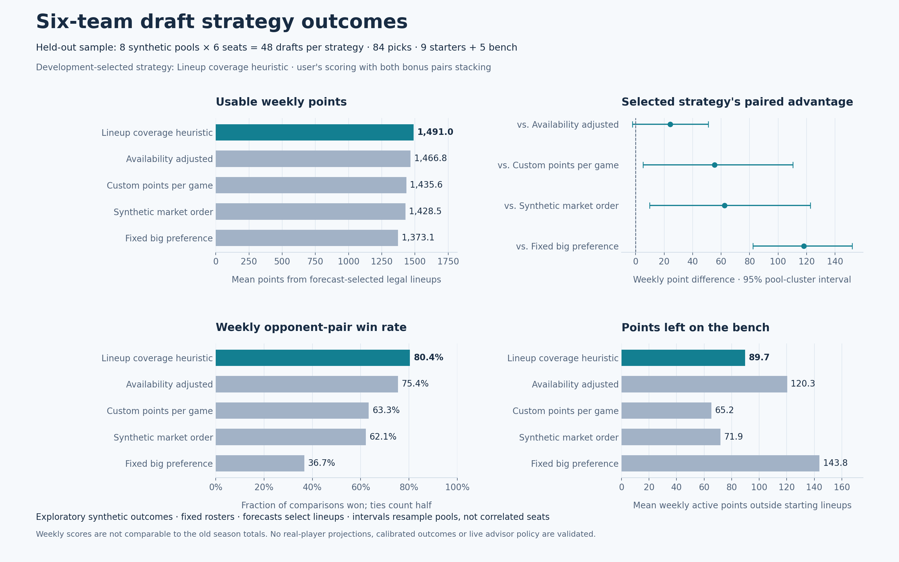

# Six-team strategy outcomes

October 17, 2026. Branch: `sleeper-advisor`. This study uses the user's supplied scoring and PG/SG/G/SF/PF/F/C/UTIL/UTIL starters plus five bench players. Both bonus pairs stack. See the [strategy profile](../../../../docs/SIX_TEAM_STRATEGY.md) and [machine-readable settings](../../../../profiles/six_team_points.json).



## Finding

Retain custom expected production, availability and exact legal lineup fit. Rebuild the old scoring and roster assumptions; avoid a fixed big-player preference. The isolated lineup-coverage heuristic won the development comparison and remained first by mean on held-out pools. This supports further evaluation of lineup-aware drafting under these assumptions; it does not validate the existing production marginal policy or Claude's separate Sleeper advisor.

| Strategy | Mean usable weekly points | Opponent-pair win fraction | Weekly benched points |
| --- | ---: | ---: | ---: |
| Lineup coverage heuristic | 1,491.0 | 80.4% | 89.7 |
| Availability adjusted | 1,466.8 | 75.4% | 120.3 |
| Custom points per game | 1,435.6 | 63.3% | 65.2 |
| Synthetic market order | 1,428.5 | 62.1% | 71.9 |
| Fixed big preference | 1,373.1 | 36.7% | 143.8 |

Lineup coverage gains **55.4 points per modeled week (+3.9%)** over custom points per game; the exploratory paired 95% interval is **+5.3 to +110.5**. Its advantage over availability alone is **24.2**, with an interval of **-2.2 to +51.1**, so that comparison is inconclusive. The fixed big preference loses 118.0 points to lineup coverage in this model (interval +82.3 to +151.9 in favor of coverage).

A lower bench total is not automatically better: custom points per game leaves fewer points on the bench but also produces fewer usable points. Win fractions compare each roster with its five modeled opponents, counting ties as half; they are not playoff or championship probabilities.

## Design

- 360 complete drafts: five heuristics × six seats × twelve independent synthetic player pools. Each draft contains 84 unique picks, six legal fourteen-player rosters and five opponents.
- Development pools 101–104 select one fixed heuristic. Held-out pools 201–208 supply the plotted results: 48 drafts per strategy, 240 held-out drafts overall. Seats share a pool and are correlated.
- Every pool contains 126 generated players with native positions. A seeded noisy custom-production ordering supplies synthetic market ranks; it is not observed Sleeper ADP. Five opponent profiles are sampled from thirteen generated styles for each seed.
- Production and coverage scores have fixed heuristic weights, not a broad search for optimal parameters. `lineup_aware` is availability-adjusted custom points plus native-position coverage and flexibility adjustments. `big_preference` adds a fixed PF/C preference to custom points. These are isolated research policies.
- Drafting and daily lineup assignment see forecast records and the synthetic availability schedule. Separate seeded per-player stat shocks provide evaluation values after selection. No hindsight lineup is substituted into the ordinary score.
- Seven modeled days per pool; generated team groups play four days, with independent health draws. The known availability schedule is assumed available to lineup selection. Rates and per-game values are constant within that simulated week; this is not a game-level calibrated NBA season model.
- The plot's 95% intervals use 4,000 paired bootstrap resamples of the eight held-out pool clusters, with RNG seed 20261017. Whole clusters retain all six seats. Multiple-comparison adjustment is not applied. Eight pools is exploratory evidence within one assumed model.
- Fixed rosters only: no waiver, streaming, trade or IR transactions. These omissions matter when judging six-team replacement depth.

## Validation and agent review

Three GPT-5.6 Luna agents at XHIGH handled assessment, implementation, and independent challenge/integration review. Review caught and corrected eligibility promotion, draft completion capacity, paired noise and inclusive bonus-rate issues before the preserved run. The final focused suite has nine passing tests, including all strategy/seat combinations, forecast-selected realized scoring, stacked bonuses, event-rate coherence across 12,600 realized records and weighted allocation checked against independent brute force. Twenty legacy fixture/strategy/contract regression tests also pass.

The settings were supplied directly by the user. This study imports no private legacy captures or player forecasts. It is excluded from the minimal application download. Weekly points here must not be compared directly with the old study's season totals or interpreted as an improvement over the fourteen-team league.

## Reproduce

From the repository root, with Python 3.10+:

```powershell
python -m unittest mock_draft.test_six_team -v
python -m mock_draft.six_team --output-dir runtime/six_team_research
python studies/six-team/2026-10-17/plot_outcomes.py runtime/six_team_research
```

The simulation uses the standard library; plotting also needs NumPy and Matplotlib. [Data](data) contains all run rows, summary statistics, development selection and profile/engine SHA-256 metadata. [Plot statistics](plot_statistics.json) preserve paired intervals. [Generated report](RESULTS.md) includes development and held-out summaries. Export formats: [PNG](strategy_outcomes.png) and [SVG](strategy_outcomes.svg).
